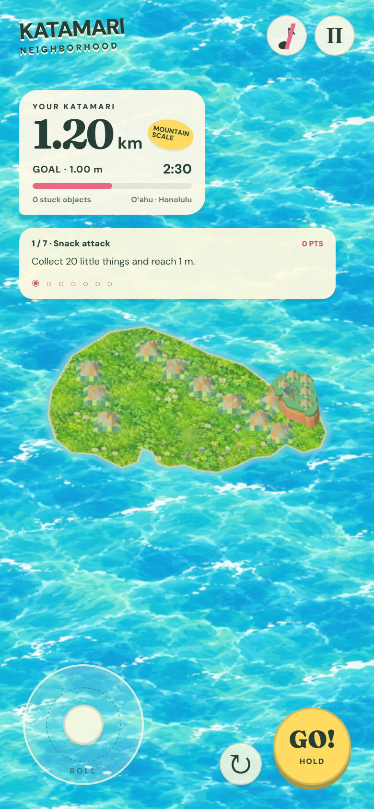

# Katamari Neighborhood

<p align="center"></p>

**[Open the browser game](https://katamari-neighborhood.remriel.chatgpt.site/)** · [How to play](#how-to-play) · [Run locally](#run-locally)

A mobile-first **3D object-collecting rolling game** inspired by Katamari, with original artwork and Blender-authored 3D props. Roll through Hawaiian island neighborhoods, collect increasingly large objects, and grow big enough to scoop up an entire island.

## What you can do

- Choose **Oʻahu** or **Lānaʻi** and move through growth checkpoints at 100 m, 200 m, 300 m, and 400 m.
- Grow your rolling ball and collect objects based on their physical sizes; the collection follows you between areas.
- Reach the final island sweep, pick up enormous landmarks, and eventually collect the island itself to win.
- Chase your best completion time. The main campaign has no deadline, and a separate four-minute quick challenge is available.
- Play on touchscreens or with a keyboard, and pause automatically when the tab loses focus.

## How to play

| Platform | Controls |
| --- | --- |
| Mobile | Drag the thumbstick to roll; hold **GO!** to dash; use the circular arrow to rotate the camera |
| Desktop | **WASD / arrows** to move, **Shift** to dash, **Q / E** to rotate, **Escape** to pause |

Sound starts muted.

## Run locally

Requires Node.js and npm:

```sh
npm install
npm run dev
```

To build the static site:

```sh
npm run build
```

Output is in `dist/`. The 3D scene uses Three.js; `src/simulation.js` handles progression and collection, `src/campaign.js` contains stages, and `src/main.js` connects the simulation to rendering, controls, and HUD. The Sites configuration is in `.openai/hosting.json`.

## Verification and scope

`node scripts/verify-four-stage-campaign.mjs` covers campaign size boundaries, island-only victory, relocation, retained collection, pause, and records. Other scripts exercise movement, terrain, navigation, and model-library invariants. Visual and mobile acceptance checks are separate.

This is an independently made fan project inspired by the object-collecting genre.

## Other browser games

- [Apex Type](https://github.com/remriel/apex-type): race classic cars by typing on a real 3D circuit.
- [Riftborne](https://github.com/remriel/riftborne): elemental arena combat in a playable browser alpha.
